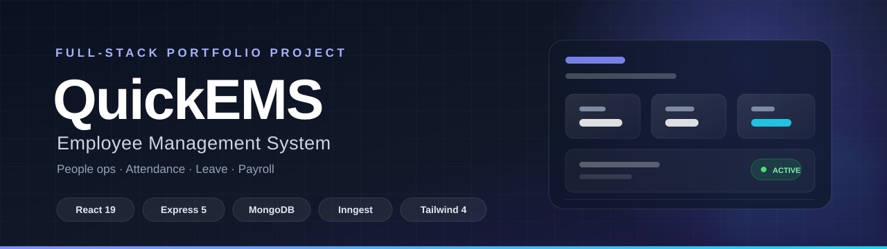
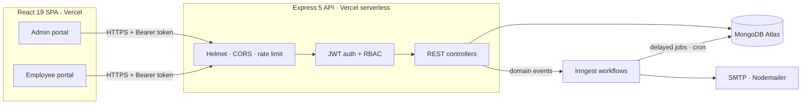
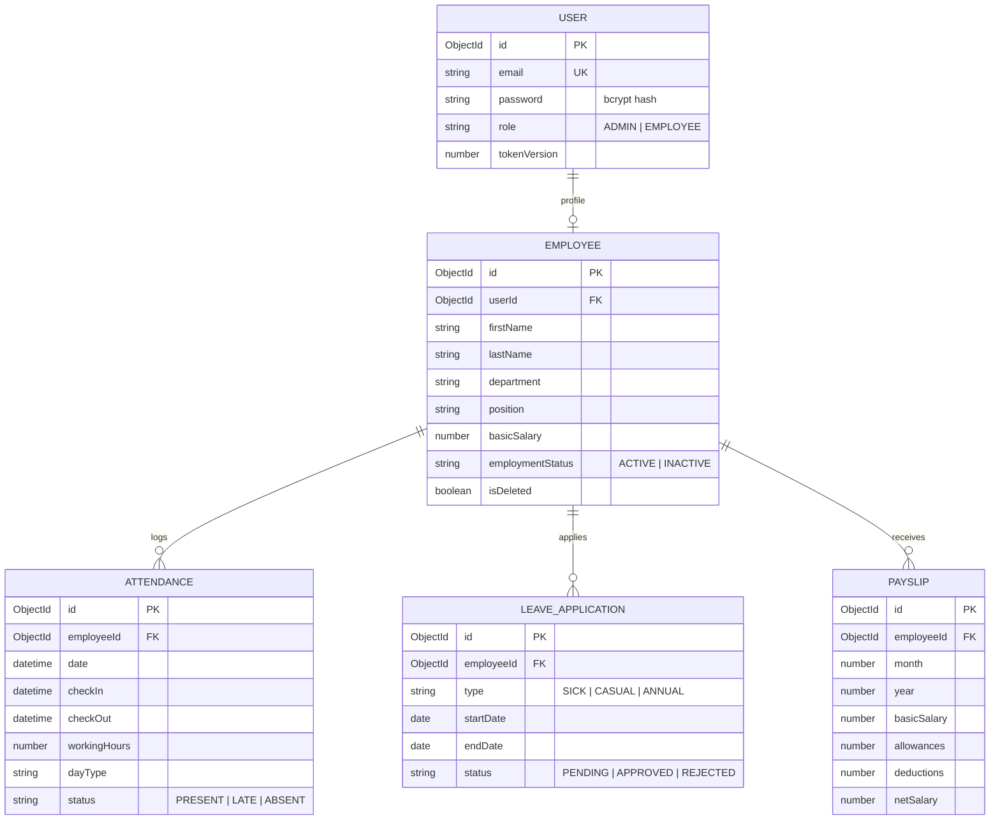

<!--
  PORTFOLIO TIP
  ─────────────
  Before sharing this repository, add:
    1. Your deployed frontend URL to the badge row / a "Live demo" link below.
    2. 2–3 screenshots in docs/screenshots/ and a "Screenshots" section.
    3. Demo credentials only if you are comfortable publishing them.
-->

<div align="center">
  
</div>

<h1 align="center">QuickEMS</h1>

<p align="center">
  <strong>Employee Management System</strong> — a production-minded full-stack portfolio project.<br/>
  People operations, attendance, leave, and payroll in one clean, role-aware workspace.
</p>

<p align="center">
  <a href="https://ems-api-henna.vercel.app"></a>
  <a href="https://github.com/willyharefa/fullstack-ems"></a>
  
  
  
  
  
</p>

<p align="center">
  <a href="#overview">Overview</a> ·
  <a href="#features">Features</a> ·
  <a href="#architecture">Architecture</a> ·
  <a href="#engineering-highlights">Engineering highlights</a> ·
  <a href="#getting-started">Getting started</a> ·
  <a href="#reviewer-tour">Reviewer tour</a>
</p>

---

> **For reviewers:** this is not just another CRUD dashboard. The interesting work is in the correctness and reliability details: timezone-safe attendance, database-enforced uniqueness, instant session revocation, soft deletes that preserve history, and durable background workflows for reminders and auto check-out. Jump to [Engineering highlights](#engineering-highlights) or take the [5-minute tour](#reviewer-tour).

## Overview

**QuickEMS** is a full-stack Employee Management System built for small teams. It gives administrators a focused people-operations console and gives employees a self-service portal for their own attendance, leave, and payslips.

The project is intentionally built as a realistic, deployable product rather than a UI demo: it includes role-based access control, server-side validation, database-level safeguards, email automation, scheduled jobs, and a serverless-friendly architecture.

### What it demonstrates

- **End-to-end product thinking** — two distinct user journeys, not one dashboard with hidden buttons.
- **Backend depth** — authentication, authorization, validation, concurrency handling, and background jobs.
- **Operational awareness** — timezone handling, soft deletes, audit-friendly history retention, and graceful failure paths.
- **Clean, responsive UI** — Tailwind CSS 4, Lucide icons, toast feedback, mobile navigation, and print-ready payslips.

## Features

| Capability | Admin | Employee |
| --- | --- | --- |
| **Dashboard** | Organization KPIs: employees, departments, today's attendance, pending leave | Personal attendance this month, pending leave, latest payslip |
| **People** | Create, edit, deactivate, search, and filter employees by department | — |
| **Attendance** | View today's check-in count | One-tap check-in / check-out, history, late tracking, working hours, day type |
| **Leave** | Review all applications, approve or reject pending requests | Apply for sick, casual, or annual leave; track status |
| **Payroll** | Generate monthly payslips, view all, open print view | View own payslips and print a clean monthly statement |
| **Account** | Change password | Edit bio, change password |

**Shared experience:** role-aware navigation, protected routes, automatic sign-out when a session becomes invalid, responsive sidebar, loading states, toast feedback, and a print-friendly payslip page.

> Attendance rules are evaluated in **Asia/Jakarta** by default: check-ins after **09:00 WIB** are marked `LATE`, working hours are computed on check-out, and the day is classified as `Full Day`, `Three Quarter Day`, `Half Day`, or `Short Day`.

## Tech stack

| Layer | Tools |
| --- | --- |
| **Frontend** | React 19, Vite 8, React Router 7, Tailwind CSS 4, Axios, Lucide React, date-fns, react-hot-toast |
| **Backend** | Node.js 22, Express 5, MongoDB, Mongoose 9, JWT, bcrypt, Helmet, express-rate-limit, Multer |
| **Automation** | Inngest (events, delayed steps, cron, retries), Nodemailer (SMTP) |
| **Deployment** | Vercel (client + serverless API), MongoDB Atlas, Inngest Cloud, SMTP provider |

## Architecture



### Background workflows

| Trigger | What happens | Why it matters |
| --- | --- | --- |
| Employee checks in | Inngest schedules a reminder **9 hours** after check-in, then forces check-out at **10 hours** if still open | Prevents forgotten check-outs without keeping a server process alive |
| Leave request created | Waits **24 hours**; if still `PENDING`, emails the admin | Keeps approvals moving without polling |
| Daily at **11:30 WIB** | Finds active employees who are not on approved leave and have not checked in, then fans out one reminder event per person | One failed email does not block the rest; each event retries independently |

Inngest steps are wrapped in `step.run` / `step.sleepUntil`, so the workflows are durable across retries and serverless cold starts.

## Engineering highlights

| Challenge | Implementation | Why it matters |
| --- | --- | --- |
| **Timezone drift** | `server/utils/timezone.js` derives day and month boundaries with `Intl.DateTimeFormat` instead of naive UTC arithmetic | "Today" and "this month" stay correct around midnight and for monthly stats |
| **Duplicate attendance** | Compound unique index on `{ employeeId, date }` plus a per-day read-then-create flow | Double clicks and concurrent requests cannot create two records for the same day |
| **Stale sessions** | `tokenVersion` is stored on the user and compared against the JWT on every protected request | Logout, password change, and deactivation revoke old tokens immediately |
| **Safe deletion** | Employees are soft-deleted (`isDeleted`, `INACTIVE`); login and API access are blocked, tokens are revoked, history is retained | Payroll and attendance history survive without leaving an active account behind |
| **Double payroll** | Unique index on `{ employeeId, month, year }`; duplicate-key errors are mapped to `409 Conflict` | Retries and races cannot create a second payslip for the same period |
| **Messy leave data** | Strict `YYYY-MM-DD` validation, future-only start dates, weekday counting, overlap detection, and pending-only approval | The approval queue stays clean and overlapping requests are rejected |
| **Serverless databases** | Mongoose connection cached on `globalThis`, reconnect handling, and a bounded pool | Fewer connection storms during cold starts and instance reuse |
| **Orphan accounts** | If employee creation fails after the user is created, the user is cleaned up | No login without a profile |
| **HTTP hardening** | Helmet, CORS allowlist, `trust proxy`, login rate limiting, generic 404/500 responses without stack traces | Safer defaults for a publicly reachable API |

## Data model



**Uniqueness guarantees:** `User.email`, `Employee.userId`, `Attendance(employeeId, date)`, and `Payslip(employeeId, month, year)`.

## API reference

Base URL: `/api`. Protected endpoints expect `Authorization: Bearer <token>`.

| Method | Endpoint | Access | Description |
| --- | --- | --- | --- |
| `POST` | `/auth/login` | Public · rate-limited | Sign in as `admin` or `employee` |
| `GET` | `/auth/session` | Authenticated | Refresh the current user from the database |
| `POST` | `/auth/change-password` | Authenticated | Change password and revoke all existing tokens |
| `POST` | `/auth/logout` | Authenticated | Revoke the current token (and all sessions) |
| `GET` | `/employees` | Admin | List employees; optional `?department=` filter |
| `POST` | `/employees` | Admin | Create an employee and linked user account |
| `PUT` | `/employees/:id` | Admin | Update employee details, role, or password |
| `DELETE` | `/employees/:id` | Admin | Soft-delete and deactivate an employee |
| `GET` | `/profile` | Authenticated | Get the current profile |
| `POST` | `/profile` | Employee | Update bio |
| `POST` | `/attendance` | Employee | Toggle check-in / check-out for today |
| `GET` | `/attendance` | Employee | Attendance history; optional `?limit=` (default 30) |
| `POST` | `/leave` | Employee | Apply for leave |
| `GET` | `/leave` | Authenticated | Admins see all; employees see their own |
| `PATCH` | `/leave/:id` | Admin | Approve or reject a **pending** request |
| `POST` | `/payslips` | Admin | Generate a monthly payslip |
| `GET` | `/payslips` | Authenticated | Admins see all; employees see their own |
| `GET` | `/payslips/:id` | Owner or Admin | Fetch a payslip for viewing / printing |
| `GET` | `/dashboard` | Authenticated | Role-specific dashboard data |
| `ALL` | `/api/inngest` | Inngest | Workflow registration and execution endpoint |

Errors are returned as JSON, for example `{ "error": "Only pending leave applications can be updated" }`.

## Project structure

```text
fullstack-ems/
├── client/
│   ├── src/
│   │   ├── api/axios.js          # Base client + auth interceptors
│   │   ├── components/           # Dashboards, forms, modals, tables
│   │   ├── context/AuthContext.jsx
│   │   ├── pages/                # Login, dashboard, employees, attendance, leave, payslips
│   │   └── App.jsx               # Routes + role guards
│   └── vercel.json               # SPA rewrites
├── server/
│   ├── config/                   # MongoDB + Nodemailer
│   ├── constants/                # Department list
│   ├── controllers/              # Request handlers
│   ├── inngest/                  # Durable workflows and cron jobs
│   ├── middleware/auth.js        # JWT verification, RBAC, account checks
│   ├── models/                   # User, Employee, Attendance, Leave, Payslip
│   ├── routes/                   # Express routers
│   ├── utils/timezone.js         # Timezone-safe day/month helpers
│   ├── seed.js                   # Creates the first admin
│   └── server.js                 # App entry point
├── docs/banner.svg
└── README.md
```

## Getting started

### Prerequisites

- **Node.js 22.x** (both packages declare `"engines": { "node": "22.x" }`)
- A **MongoDB** database — local or a free MongoDB Atlas cluster
- Optional: SMTP credentials for email notifications
- Optional: an Inngest account for cloud workflows

### 1. Clone the repository

```bash
git clone https://github.com/willyharefa/fullstack-ems.git
cd fullstack-ems
```

### 2. Configure the API

```bash
cd server
cp .env.example .env
# Fill in MONGODB_URI, JWT_SECRET, and ADMIN_EMAIL at minimum
npm install
npm run seed
npm run dev
```

The API runs on `http://localhost:4000`. The seed script creates an admin using `ADMIN_EMAIL` with the temporary password **`admin123`** — change it immediately after your first login.

### 3. Configure the client

In a second terminal:

```bash
cd client
cp .env.example .env
npm install
npm run dev
```

Open `http://localhost:5173`. Use the dedicated entry points:

- Admin: `http://localhost:5173/login/admin`
- Employee: `http://localhost:5173/login/employee`

### 4. Optional: run background workflows locally

Start the Inngest Dev Server in another terminal and set `INNGEST_DEV=1` in `server/.env`:

```bash
npx inngest-cli@latest dev
```

Without Inngest, the core CRUD flows still work; reminders, auto check-out, and the daily attendance cron will not run.

### Environment variables

**Server (`server/.env`)**

| Variable | Required | Purpose |
| --- | --- | --- |
| `MONGODB_URI` | Yes | MongoDB connection string |
| `JWT_SECRET` | Yes | Signs 7-day JWTs; use 32+ random characters |
| `ADMIN_EMAIL` | Yes | Seed admin account and leave-reminder recipient |
| `CLIENT_URL` | Production | Comma-separated list of allowed CORS origins |
| `PORT` | No | Local API port (default `4000`) |
| `TIME_ZONE` | No | IANA timezone (default `Asia/Jakarta`) |
| `SMTP_HOST`, `SMTP_USER`, `SMTP_PASS`, `SENDER_EMAIL` | For email | Nodemailer SMTP transport |
| `INNGEST_EVENT_KEY`, `INNGEST_SIGNING_KEY` | For workflows | Inngest Cloud credentials |
| `INNGEST_DEV` | Local only | Set to `1` when using the Inngest Dev Server |

**Client (`client/.env`)**

| Variable | Required | Purpose |
| --- | --- | --- |
| `VITE_BASE_URL` | Yes | API origin, without `/api` (e.g. `https://ems-api-henna.vercel.app`) |

## Deployment

The repository is already shaped for a two-project Vercel deployment.

### API → Vercel

1. Import the repository and set the **root directory** to `server`.
2. Add `MONGODB_URI`, `JWT_SECRET`, `ADMIN_EMAIL`, `CLIENT_URL`, SMTP variables, and Inngest keys.
3. Deploy. `server.js` exports the Express app and only calls `app.listen()` when `VERCEL` is not set.
4. Set `CLIENT_URL` to your deployed frontend origin(s), comma-separated.
5. In Inngest, sync the app at `https://<your-api-domain>/api/inngest` and add the event/signing keys.

### Client → Vercel

1. Import the same repository with the **root directory** set to `client`.
2. Set `VITE_BASE_URL` to the deployed API origin (no `/api` suffix).
3. Deploy. `client/vercel.json` rewrites all routes to `index.html` for client-side routing.

### Database → MongoDB Atlas

Create a database user and allow connections from your deployment. For a portfolio demo, `0.0.0.0/0` is convenient but broad; for anything real, restrict network access and use least-privilege credentials.

## Reviewer tour

A quick path through the product in about five minutes after running it locally (or on your deployed demo):

1. Sign in at `/login/admin` with the seeded admin account.
2. Open **Employees** → **Add Employee** and create an employee (set a password).
3. Sign out and sign in at `/login/employee` as that employee.
4. Open **Attendance** and check in; then open **Leave** and submit a future-dated request.
5. Sign back in as admin: approve the leave and generate a payslip in **Payslips**.
6. Open the payslip print view, then check the employee's dashboard and attendance history.

## Trade-offs and next steps

This project is production-minded, not production-perfect. The current scope is deliberate:

- **JWT is stored in `localStorage`.** Convenient for a SPA, but `httpOnly` cookies with refresh-token rotation would reduce XSS exposure.
- **Login rate limiting is in-memory.** In serverless, limits reset per instance; a Redis-backed store is the right next step.
- **Lists are unpaginated.** Fine for small teams, not for thousands of employees or payslips.
- **No automated tests yet.** This is the highest-value gap to close next.

Planned improvements:

- [ ] Unit and integration tests with Vitest + Supertest, plus a Playwright smoke test
- [ ] GitHub Actions CI for lint, test, and build
- [ ] Redis-backed rate limiting and refresh-token rotation
- [ ] Audit log for payroll, leave, and employee changes
- [ ] OpenAPI 3 documentation
- [ ] Docker Compose for one-command local setup
- [ ] Structured logging and error tracking
- [ ] Accessibility pass and pagination for large datasets

## Author

**Willy Harefa** — full-stack developer

- GitHub: [@willyharefa](https://github.com/willyharefa)
- Email: [willyandrioharefa16@gmail.com](mailto:willyandrioharefa16@gmail.com)
- Live API: [ems-api-henna.vercel.app](https://ems-api-henna.vercel.app)

Open to feedback, collaboration, and opportunities.

---

<p align="center">
  <sub>Built with React, Express, MongoDB, Tailwind CSS, and Inngest.</sub>
</p>
